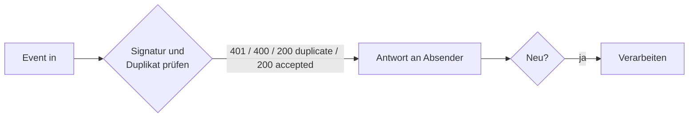
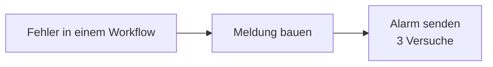
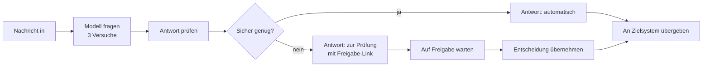

# n8n-reliability-patterns

Drei n8n-Workflows für das, woran Automatisierungen in der Praxis scheitern: doppelte oder gefälschte Webhooks, Fehler, die niemand bemerkt, und KI-Antworten, denen man blind vertraut.

Jeder Workflow lässt sich direkt in n8n importieren. Ein Testlauf startet n8n in Docker und prüft alle drei mit echten HTTP-Aufrufen (16 Prüfungen).

| Workflow | Problem | Lösung |
|---|---|---|
| [01 Signierter Webhook](workflows/01-signed-webhook.json) | Shop, Payment oder CRM schickt Events doppelt (Retries), oder jemand ruft die URL mit erfundenen Daten auf. | HMAC-SHA256-Signatur prüfen, jede Event-ID nur einmal annehmen, Absender bekommt eine klare Antwort. |
| [02 Fehler-Workflow mit Alarm](workflows/02-error-alert.json) | Ein Workflow scheitert nachts, und erst der Kunde merkt es. | Zentraler Error-Workflow: Name, Knoten, Fehler und Link zur Ausführung gehen sofort an Slack, Teams oder Discord. |
| [03 KI-Einordnung mit Freigabe](workflows/03-classify-with-approval.json) | Das Sprachmodell antwortet falsch, unsicher oder gar nicht, und der Fehler landet im Zielsystem. | Antwort gegen ein Schema prüfen; nur sichere Antworten laufen automatisch weiter, alles andere wartet auf die Freigabe durch einen Menschen. |

## 01 Signierter Webhook mit Duplikat-Schutz



- Der Absender signiert den Rohtext: Header `X-Signature: sha256=<hex>`, HMAC-SHA256 mit `WEBHOOK_SECRET`.
- Verglichen wird mit `timingSafeEqual`. Ein leerer oder kurzer Schlüssel (unter 32 Zeichen) lässt den Workflow scheitern, statt alles durchzulassen.
- Antworten: `401 invalid_signature`, `400 invalid_json` / `missing_id`, `200 duplicate`, `200 accepted`. Ein Duplikat bekommt bewusst 200, damit der Absender nicht weiter wiederholt.
- Gesehene IDs liegen in den Static Data des Workflows und werden nach 7 Tagen vergessen.

**Grenze:** Static Data reicht für eine n8n-Instanz. Bei mehreren Workern oder gleichzeitig eintreffenden Duplikaten gehört die ID in eine Tabelle mit eindeutigem Schlüssel (z. B. Postgres, `INSERT … ON CONFLICT DO NOTHING`). Die ID wird beim Annehmen gemerkt, also vor der Verarbeitung: Scheitert die Verarbeitung, meldet Workflow 02 das, und der Fall wird bewusst von Hand nachgeholt, statt doppelt zu laufen.

## 02 Fehler-Workflow mit Alarm



- In jedem Workflow unter *Settings → Error Workflow* diesen Workflow eintragen (bei 01, 02b und 03 schon gesetzt).
- Die Meldung geht als `{"text": …}` an `ALERT_WEBHOOK_URL`. Das versteht ein Slack- oder Discord-Incoming-Webhook direkt; für Teams oder Telegram nur den letzten Knoten tauschen.
- `02b-failing-demo.json` scheitert absichtlich und zeigt den Alarm.

## 03 KI-Einordnung mit Freigabe durch einen Menschen



- Das Modell soll eine von vier Kategorien liefern (`rechnung`, `bestellung`, `reklamation`, `sonstiges`) plus `confidence`.
- **Automatisch** nur, wenn die Antwort gültiges JSON ist, die Kategorie erlaubt ist und `confidence >= CONFIDENCE_THRESHOLD` (Standard 0.8).
- **Zur Prüfung** geht alles andere: unsichere Antwort, Kategorie außerhalb des Schemas, kein JSON, Modell nicht erreichbar. Der Absender bekommt einen signierten Freigabe-Link mit dem Vorschlag; über `category=…` lässt sich eine andere Kategorie wählen. Erst danach wird übergeben.
- Jede Übergabe sagt, wer entschieden hat: `decidedBy: "model"` oder `"human"`.
- Das Modell wird über eine OpenAI-kompatible Schnittstelle angesprochen (`LLM_BASE_URL`, `LLM_MODEL`). Das passt zu OpenAI, Mistral, Gemini (OpenAI-kompatibler Endpunkt) oder einem lokalen Ollama. Der API-Schlüssel liegt als n8n-Credential *LLM API* (Header Auth), nicht im Workflow.

**Grenze:** Der Freigabe-Link läuft nicht ab. Für den Betrieb beim Wait-Knoten ein Zeitlimit setzen und den Ablauf nach Fristende an eine Eskalation hängen.

## Einrichten in einer eigenen n8n-Instanz

1. Umgebungsvariablen setzen:

   | Variable | Wofür |
   |---|---|
   | `WEBHOOK_SECRET` | 01: gemeinsamer Schlüssel mit dem Absender, mindestens 32 Zeichen (`openssl rand -hex 32`) |
   | `ALERT_WEBHOOK_URL` | 02: Incoming-Webhook von Slack, Discord o. Ä. |
   | `LLM_BASE_URL`, `LLM_MODEL` | 03: z. B. `https://api.openai.com/v1` und ein Modellname |
   | `CONFIDENCE_THRESHOLD` | 03: optional, Standard `0.8` |
   | `HANDOVER_URL` | 03: wohin das Ergebnis geht (CRM, Ticketsystem, eigener Dienst) |
   | `N8N_BLOCK_ENV_ACCESS_IN_NODE=false` | damit die Workflows die Variablen lesen dürfen |
   | `NODE_FUNCTION_ALLOW_BUILTIN=crypto` | für die Signaturprüfung in 01 |

2. Workflows importieren: `n8n import:workflow --separate --input=workflows/` oder im Editor über *Import from File*.
3. In n8n ein Credential vom Typ *Header Auth* mit dem Namen `LLM API` anlegen (`Authorization` / `Bearer <API-Schlüssel>`) und in Workflow 03 auswählen.
4. Workflows veröffentlichen.

## Tests

```bash
python tests/run_tests.py
```

Braucht Docker und Python 3, keine weiteren Pakete. Der Lauf

- startet n8n `2.44.6` (Image per Digest festgelegt) in einem Wegwerf-Container auf Port 5690,
- importiert die Workflows und ein Test-Credential und veröffentlicht sie,
- spielt mit einem lokalen Stub das Sprachmodell, den Alarm-Empfänger und das Zielsystem,
- prüft 16 Fälle: gültige, doppelte, falsch und gar nicht signierte Events, Event ohne ID, Alarm mit Workflow-Name, Knoten und Fehler, sichere und unsichere KI-Antworten, Freigabe mit geänderter Kategorie, kaputte Modellantwort, Kategorie außerhalb des Schemas,
- räumt den Container am Ende wieder ab.

## Lizenz

MIT für die Workflows und Tests in diesem Repository. n8n selbst steht unter der Sustainable Use License.
